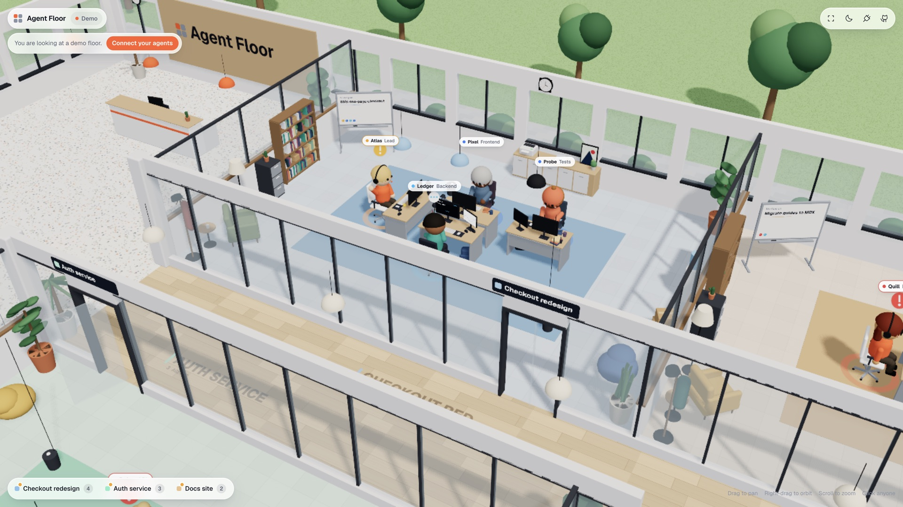
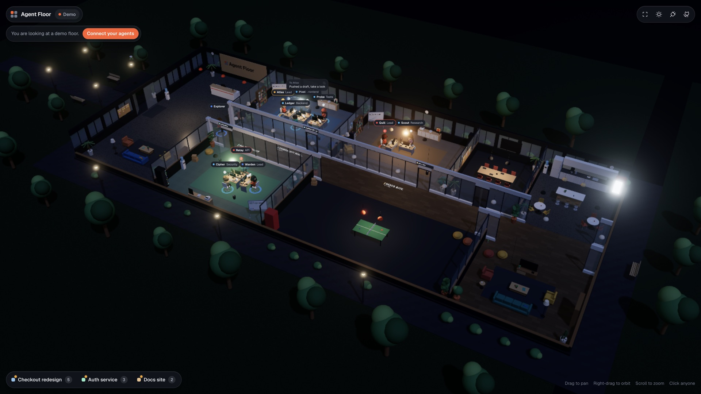

# Agent Floor

A live 3D office for your coding agents.

Every agent gets a character and a desk inside one office building. Each project or team gets its own glass-walled office block off the main corridor, next to a lobby, kitchen, meeting room and lounge. You can watch agents walk in the front door, find their desk, type, think, raise a hand when they need you, and throw paper planes at each other when they talk. Click anyone to see exactly what they are doing.

Works with **Claude Code**, **Codex**, **Cursor**, and anything else that can send an HTTP request.

**[Try the live demo](https://develop212.github.io/agent-floor/)** (runs in your browser, no install).





## Quick start

```bash
npm i -g agent-floor
agent-floor setup claude --write
```

That's it. The next time a Claude Code session starts, Agent Floor opens by itself in its own desktop window (no browser). Close the window and it keeps listening from the menu bar; use **Quit (pause auto-open for 6 hours)** in the menu bar icon when you want quiet. Run `agent-floor` any time to open it yourself.

Start a Claude Code session in any project. A character walks into a room named after the project folder, sits down, and starts working. When it spawns a subagent, a new teammate walks in, gets briefed with a paper plane, works at its own desk, and reports back.

No agents yet? Click **Watch demo**, or run `agent-floor demo` in a second terminal.

## What you see

| On the floor | Means |
| --- | --- |
| An office block | One project, or whatever `team` you send. Name above the door and on the corridor floor, current task on the rolling whiteboard. |
| Character at a desk | One agent. The lead sits at the head of the desk pod. |
| Typing, code scrolling on the monitor | `working`: running a tool. The screen shows the tool and what it is doing. |
| Hand on chin, thought bubble | `thinking` |
| Waving, amber badge | `waiting`: it needs you |
| Head shake, red badge | `error` |
| Little hop, green check | `done` |
| Leaning back, screensaver | `idle` |
| Paper plane on an arc | A message from one agent to another, colour of the sender's team |
| Walking in the front door, down the corridor | An agent joining (or, in reverse, leaving) |

Coloured magnets on each whiteboard show every team member's status at a glance.

**Controls:** drag to pan, right-drag to orbit, scroll to zoom, click an agent or a room. `F` frames everyone, `[` and `]` step through agents, `T` switches day and night, `Esc` closes things. On touch: one finger pans, two fingers zoom and rotate.

## Connect your tools

### Claude Code

```bash
agent-floor setup claude --write     # merges hooks into ~/.claude/settings.json (backup kept)
agent-floor setup claude --project   # prints a snippet for .claude/settings.json in this repo
```

Uses `SessionStart`, `UserPromptSubmit`, `PreToolUse`, `PostToolUse`, `Notification`, `Stop`, `SubagentStop`, `PreCompact` and `SessionEnd`. Subagents spawned with the Task tool get their own desks and their tool calls show up on their own screens.

### Codex

```bash
agent-floor setup codex
```

Prints the `notify` line for `~/.codex/config.toml`. Codex reports once per finished turn. If your Codex build supports Claude-style hooks, point them at `agent-floor hook codex` and you get live tool activity too.

### Cursor

```bash
agent-floor setup cursor --write     # ~/.cursor/hooks.json
agent-floor setup cursor --project   # .cursor/hooks.json in this repo
```

Only observing hooks are installed. Agent Floor never answers a permission prompt for you.

### Anything else

Post JSON to `http://localhost:4317/events`:

```bash
curl -X POST localhost:4317/events \
  -H 'content-type: application/json' \
  -d '{"type":"tool","agent":"bot-1","team":"Payments","tool":"Bash","activity":"Running tests"}'
```

Or from a shell script:

```bash
agent-floor emit --agent bot-1 --team Payments --status working --activity "Running tests"
agent-floor emit --agent bot-1 --to bot-2 --text "Tests are green"
```

The full event format is in [docs/protocol.md](docs/protocol.md). More integration notes, including LangGraph and CrewAI style frameworks, are in [docs/integrations.md](docs/integrations.md).

## Configuration

| Variable | Default | Used by |
| --- | --- | --- |
| `AGENT_FLOOR_PORT` | `4317` | server, hooks |
| `AGENT_FLOOR_HOST` | `127.0.0.1` | server |
| `AGENT_FLOOR_URL` | `http://127.0.0.1:4317` | hooks, `emit`, `demo` |
| `AGENT_FLOOR_TEAM` | project folder name | hooks: put this session in a named room |
| `AGENT_FLOOR_NAME` | `Claude`, `Codex`, `Cursor` | hooks: the lead's display name |
| `AGENT_FLOOR_AUTOLAUNCH` | `1` | set to `0` so hooks never open the app |

Group several repos into one room by giving them the same `AGENT_FLOOR_TEAM`.

## Privacy and safety

- The server binds to `127.0.0.1` and only answers loopback host names.
- `POST` requires `Content-Type: application/json`, so web pages cannot fire simple cross-site requests at it. CORS is limited to localhost origins.
- Hooks time out after 1.2 seconds, swallow every error and always exit 0. If the floor is down, your agents never notice.
- Nothing is stored on disk and nothing is sent anywhere else. Activity text is clipped to 280 characters.

## The desktop app

`agent-floor` (or the first hook event when nothing is running) starts the floor and opens it as an Electron window. If Electron is not available, it falls back to a Chrome or Edge app window, and then to your default browser. Only one copy ever runs: parallel subagents share a launch lock. `agent-floor start` runs just the server, with no window, if you prefer a browser tab at http://localhost:4317.

## Performance

Static furniture is batched into a few meshes per room with colours baked into vertices, characters are one mesh per moving part, shadows refresh a few times a second, monitors only redraw near the camera, and the render resolution adapts to your frame rate. A building with 50+ agents holds 60 fps on an M-series MacBook. Add `?stats` to the URL (or `agent-floor demo --agents 60` for a stress test) to see draw calls, frame time and rebuild cost.

## How it works

```
Claude Code / Codex / Cursor hooks ──┐
agent-floor emit, curl, your code ───┼──► POST /events ──► reducer ──► GET /stream (SSE) ──► browser
                                     │                       │                                │
                                     └─ adapters/*.mjs       └─ shared/protocol.js ◄──────────┘
                                        map native payloads     same reducer runs on both sides
```

- `server/` is a zero-dependency Node HTTP server. `npx agent-floor` installs nothing else.
- `shared/protocol.js` is the event reducer, used verbatim by the server and the browser, so a snapshot plus the stream always matches.
- `adapters/` turn each tool's hook payload into floor events. They are pure functions with tests.
- `src/world/` is the three.js scene: rooms, desks, characters, paper planes and the camera rig.
- `src/ui/` is the HUD: name tags, speech bubbles, the agent card and the connect sheet.
- `desktop/` is the Electron shell: native window, tray icon, single instance, auto-launch state.

## Develop

```bash
git clone https://github.com/develop212/agent-floor
cd agent-floor
npm install
npm run dev        # floor server on :4317 + Vite on :5173
npm run demo       # in another terminal, stream fake agents
npm test           # protocol, adapters, server
npm run build      # typecheck + production build into dist/
```

`npm run build:pages` builds a demo-only version into `dist-pages/` for GitHub Pages. The included workflow publishes it on every push to `main`.

See [CONTRIBUTING.md](CONTRIBUTING.md) for how the scene is put together and what makes a good adapter.

## License

MIT
